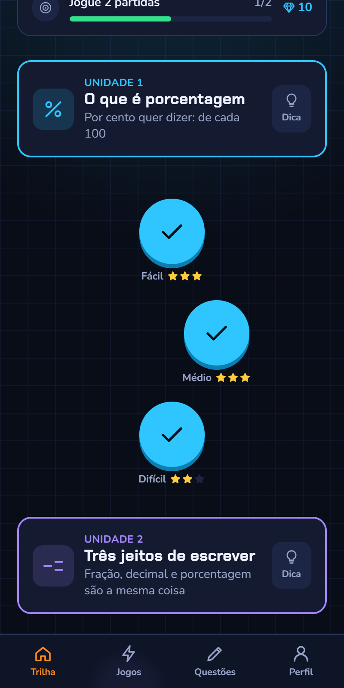
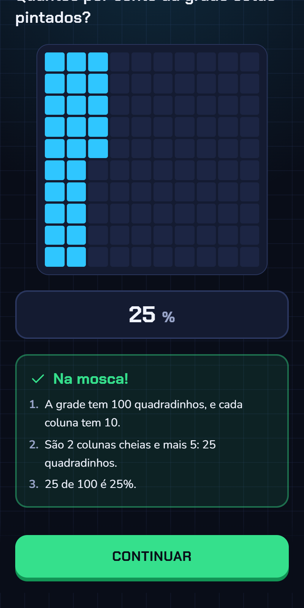
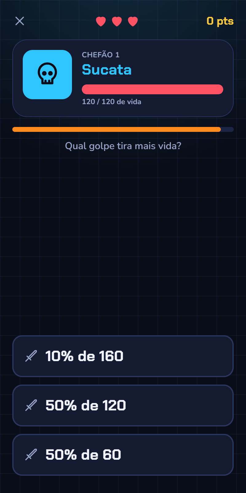
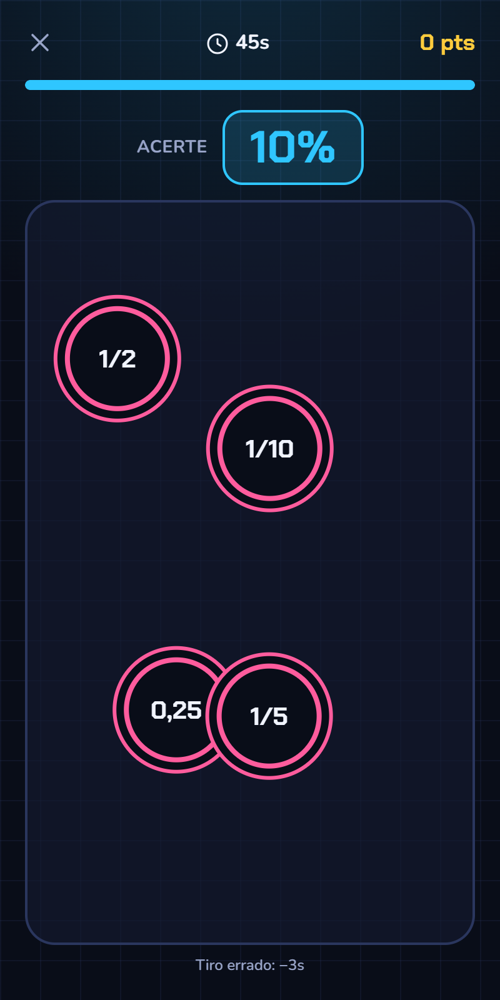
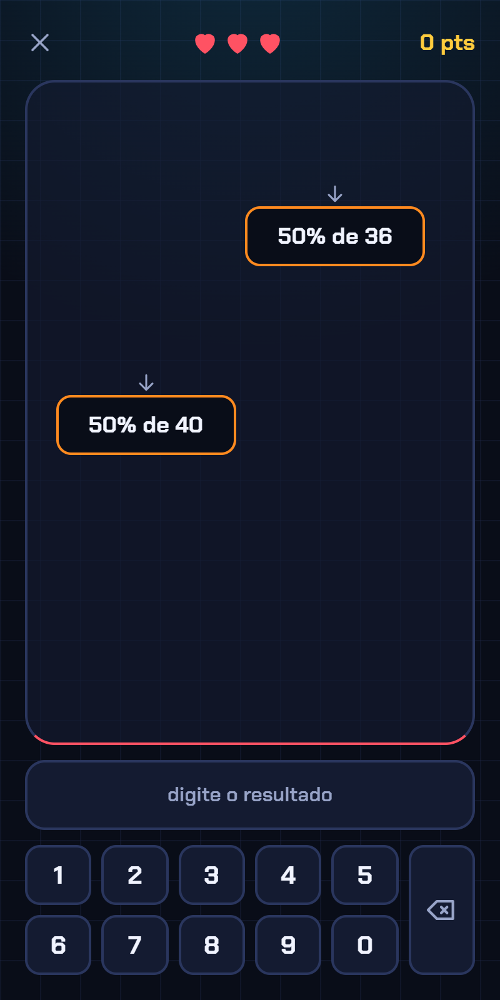
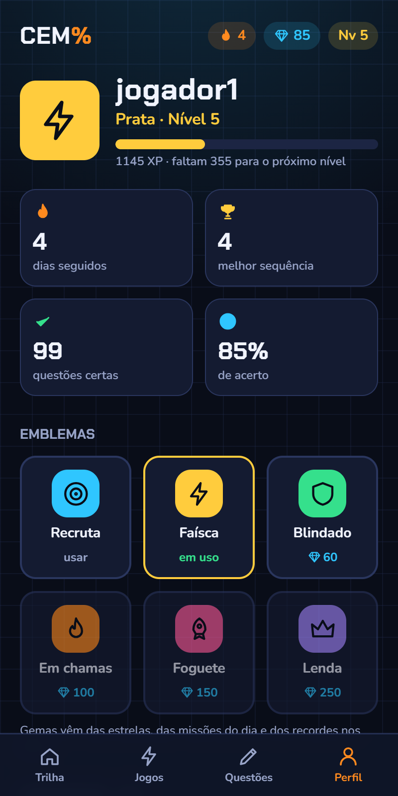

# Cem%

Porcentagem do 6º ano em formato de jogo. Fiz para um aluno que estava travado nesse conteúdo e que gosta
muito mais de jogar do que de fazer lista de exercício: a ideia é ele treinar sem sentir que está estudando.

Tem uma trilha de fases, um treino livre de questões e cinco minijogos. É o mesmo molde do
[Tiradentes](https://github.com/luispereiratr-glitch/Tiradentes), só que sem ranking, porque aqui joga uma pessoa só.

| Trilha | Questão resolvida | Duelo de Dano |
| :---: | :---: | :---: |
|  |  |  |
| **Mira Certa** | **Chuva de Caixas** | **Perfil** |
|  |  |  |

## O que tem

**Trilha.** Oito unidades, cada uma com três fases (fácil, médio e difícil):

1. O que é porcentagem
2. Fração, decimal e porcentagem
3. Os atalhos: 50%, 25%, 10% e 1%
4. Montando qualquer porcentagem a partir dos atalhos
5. Desconto
6. Aumento
7. Que porcentagem é? (da parte e do todo para a porcentagem)
8. Chefão: problemas de dois passos e de trás para frente

Cada unidade abre com uns cartões curtos de explicação. O que ele erra volta no fim da fase até acertar, e
toda questão mostra a resolução do jeito que se faz de cabeça, sem regra de três.

**Questões.** Treino livre por tema e dificuldade, com um modo que puxa as habilidades em que ele mais erra.
As questões não vêm de uma lista: cada habilidade tem um gerador que sorteia os números e monta o enunciado,
a resposta e os passos, então elas não acabam nem se repetem.

**Jogos.**

| Jogo | Como é | O que treina |
| --- | --- | --- |
| Duelo de Dano | Três golpes, cada um é uma conta; o mais forte dá crítico | Calcular e comparar porcentagens |
| Chuva de Caixas | As contas caem e ele digita o resultado antes de tocarem o chão | Cálculo mental rápido |
| Mira Certa | Atirar no alvo que vale o mesmo que o pedido (1/4, 25%, 0,25) | Fração, decimal e porcentagem |
| Trava na Zona | Parar a barra na porcentagem pedida | Noção visual de quanto é cada porcentagem |
| Caça-Ofertas | Duas ofertas com descontos diferentes: qual sai mais barata? | Desconto e taxa |

**O resto.** XP e níveis, sequência de dias, missões diárias, gemas para trocar por emblemas, conquistas e um
mapa de acerto por habilidade no perfil.

## Feito com

Next.js (App Router), TypeScript, Tailwind e Supabase para as contas e o progresso. Hospedado na Vercel.
Os sons são gerados na hora com Web Audio, sem arquivo de áudio.

## Rodar no computador

```bash
npm install
npm run dev
```

Abra http://localhost:3000. Sem configurar o banco, o app roda em **modo local**: basta digitar um nick,
e o progresso fica salvo só naquele navegador.

## Ligar as contas com senha (Supabase)

1. Crie um projeto em https://supabase.com.
2. No SQL Editor, rode o conteúdo de `supabase/schema.sql`.
3. Copie `.env.example` para `.env.local` e preencha as três chaves (Project Settings > API).
4. Reinicie o `npm run dev`.

O login usa só nick e senha. Como não há e-mail, não existe "esqueci minha senha": para trocar a senha,
use Authentication > Users no painel do Supabase (o usuário aparece como `nick@estudos.invalid`).

## Publicar (Vercel)

Importe o repositório na Vercel e cadastre as mesmas três variáveis de ambiente do `.env.local`.

## Onde fica cada coisa

| Pasta | Conteúdo |
| --- | --- |
| `src/conteudo/unidades.ts` | A trilha: as 8 unidades, com as dicas e as habilidades de cada uma |
| `src/conteudo/geradores.ts` | Os geradores de questões, um por habilidade, com a resolução passo a passo |
| `src/lib/jogo.ts` | Regras de XP, níveis, sequência de dias, estrelas, gemas, missões e emblemas |
| `src/lib/jogos.ts` | Lista dos minijogos (nome, regra, cor, conquista) |
| `src/lib/app.tsx` | Login e progresso do jogador |
| `src/components/Sessao.tsx` | Tela de questões: múltipla escolha, digitar o número e pintar a grade |
| `src/app/` | Telas: trilha, fase, dica, questões, jogos e perfil |
| `src/app/globals.css` | Cores e animações |
| `supabase/schema.sql` | Tabela e regra de acesso do banco |

## Como adicionar um tipo de questão

Em `src/conteudo/geradores.ts`:

1. Escreva o gerador (recebe o nível 1, 2 ou 3 e devolve um exercício `escolha`, `digitar` ou `pintar`).
2. Registre em `HABILIDADES`, com o nome que aparece no perfil.
3. Inclua o id na lista `habilidades` de uma unidade em `src/conteudo/unidades.ts`.

O id não deve mudar depois: os acertos e erros do jogador são guardados por ele.
